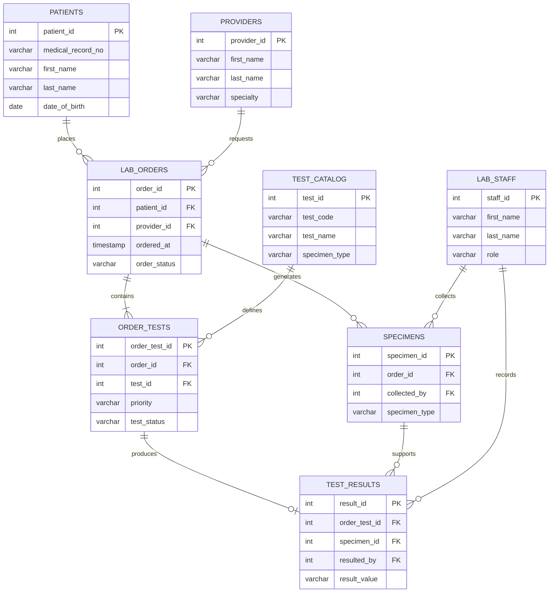

# Entity Relationship Diagram (ERD)

## MediLab Hospital Laboratory System

The following ERD represents the relationships between the eight database entities.

## Relationship Explanation

1. A patient can have multiple laboratory orders.
2. A provider can request multiple laboratory orders.
3. A laboratory order can contain multiple tests.
4. A test catalog entry can be used in multiple orders.
5. A laboratory order can generate multiple specimens.
6. A laboratory staff member can collect multiple specimens.
7. An ordered test can produce zero or one result.
8. A specimen can be associated with multiple test results.
9. A laboratory staff member can record multiple test results.

## Conclusion

The ERD illustrates the logical structure of the MediLab database and demonstrates how primary keys and foreign keys establish relationships between the entities.
